# UML Компонентна діаграма системи онлайн-доставки їжі (Lab 5)

Діаграма описує компонентно-модульну архітектуру системи: внутрішні шари (`UI`, `API / Backend`, `Application Services`, `Data Access`, `Database`), чітку межу системи (`System Boundary`), інтерфейси (`provided` / `required`) та взаємодію із зовнішніми сервісами.

```mermaid
flowchart TB
    subgraph SystemBoundary["«system» Сервіс онлайн-доставки їжі (System Boundary)"]
        subgraph UILayer["1. Шар представлення (UI)"]
            WebUI["«component»<br/>Web Client UI<br/>(Каталог, Кошик/OrderUI, Кабінет менеджера та кур'єра)"]
        end

        I_PublicAPI(["«interface»<br/>IOrderAPI / ICatalogAPI / IOpsAPI"])

        subgraph APILayer["2. Шар шлюзу (API / Backend)"]
            APIGW["«component»<br/>REST API Gateway<br/>(Маршрутизація, TLS 1.3, RBAC, Webhook Endpoint)"]
        end

        I_OrderSvc(["«interface»<br/>IOrderService"])
        I_PaySvc(["«interface»<br/>IPaymentService"])
        I_CatalogOps(["«interface»<br/>ICatalogService / IOpsService"])

        subgraph ServiceLayer["3. Шар бізнес-логіки (Application Services)"]
            OrderSvc["«component»<br/>OrderService<br/>(Валідація замовлення та стани Order.status)"]
            PromoSvc["«component»<br/>PromoConfigService<br/>(Статичні правила знижок)"]
            PaySvc["«component»<br/>PaymentService<br/>(Сесії оплати, таймаут 15 хв, webhook)"]
            CatalogOpsSvc["«component»<br/>Catalog & Operations Service<br/>(Меню UC-1, Кухня UC-3, Доставка UC-4)"]
        end

        I_Promo(["«interface»<br/>IPromoConfig"])
        I_OrderRepo(["«interface»<br/>IOrderRepository"])
        I_CatalogRepo(["«interface»<br/>ICatalogRepository"])

        subgraph DALayer["4. Шар доступу до даних (Data Access)"]
            DAL["«component»<br/>Data Access Layer (Repositories)<br/>(User, Restaurant, Dish, Order, OrderItem, Courier)"]
        end

        I_DB(["«interface»<br/>ISQLConnection"])

        subgraph DBLayer["5. Шар збереження даних (Database)"]
            DB[("«database»<br/>PostgreSQL Database (3NF)<br/>6 нормалізованих таблиць")]
        end
    end

    %% Інтерфейси на межі системи (Boundary Interfaces)
    I_Webhook(["«interface»<br/>IPaymentWebhook"])
    I_PayGW(["«interface»<br/>IPaymentGatewayClient"])
    I_Notify(["«interface»<br/>INotificationGateway"])
    I_Auth(["«interface»<br/>IAuthVerify"])

    %% Зовнішні інтеграції (External Systems)
    PayGW["«external system»<br/>Payment Gateway<br/>(Зовнішній платіжний шлюз)"]
    NotifyExt["«external system»<br/>Notification Provider<br/>(Push / Email / SMS сповіщення)"]
    AuthExt["«external system»<br/>Identity / Auth Provider<br/>(OAuth2 / JWT та RBAC-ролі)"]

    %% Зв'язки UI -> API Gateway
    WebUI -.->|required| I_PublicAPI
    APIGW ---|provided| I_PublicAPI

    %% Зв'язки API Gateway -> Services
    APIGW -.->|required| I_OrderSvc
    OrderSvc ---|provided| I_OrderSvc

    APIGW -.->|required| I_PaySvc
    PaySvc ---|provided| I_PaySvc

    APIGW -.->|required| I_CatalogOps
    CatalogOpsSvc ---|provided| I_CatalogOps

    %% Внутрішні залежності між сервісами
    OrderSvc -.->|required| I_Promo
    PromoSvc ---|provided| I_Promo

    OrderSvc -.->|required| I_PaySvc
    PaySvc -.->|required| I_OrderSvc

    %% Зв'язки Services -> Data Access -> Database
    OrderSvc -.->|required| I_OrderRepo
    CatalogOpsSvc -.->|required| I_OrderRepo
    DAL ---|provided| I_OrderRepo

    CatalogOpsSvc -.->|required| I_CatalogRepo
    DAL ---|provided| I_CatalogRepo

    DAL -.->|required| I_DB
    DB ---|provided| I_DB

    %% Зовнішні інтеграції через межу системи
    APIGW -.->|required| I_Auth
    AuthExt ---|provided| I_Auth

    PaySvc -.->|required| I_PayGW
    PayGW ---|provided| I_PayGW

    PayGW -.->|required| I_Webhook
    APIGW ---|provided| I_Webhook

    OrderSvc -.->|required| I_Notify
    NotifyExt ---|provided| I_Notify
```

