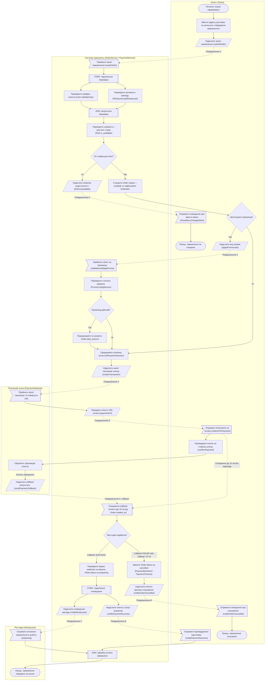

# Activity-діаграма бізнес-процесу «Оформлення та оплата замовлення» (UC-2)

Діаграма деталізує наскрізний процес прецеденту **UC-2 «Оформити замовлення»** (разом із розширенням промокоду `UC-6` та включеною оплатою `UC-5`) у нотації Activity (`Mermaid flowchart TD`) із розподілом на доріжки ролей, паралельними гілками (`Fork`/`Join`) та явними повідомленнями між учасниками.

