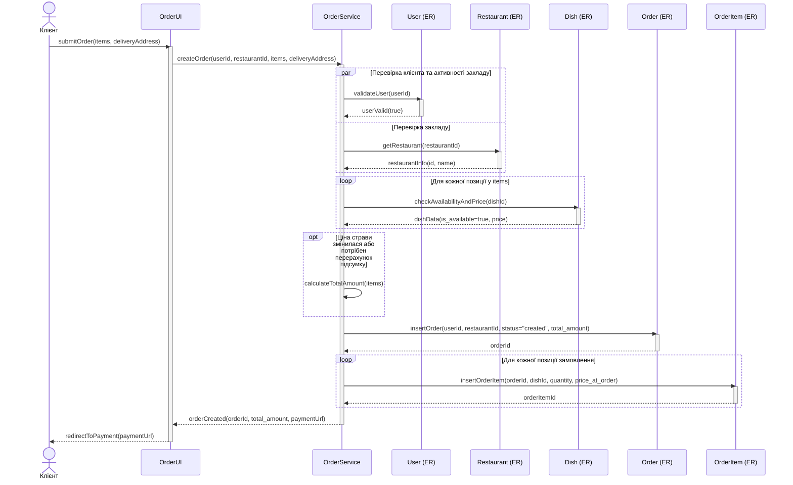
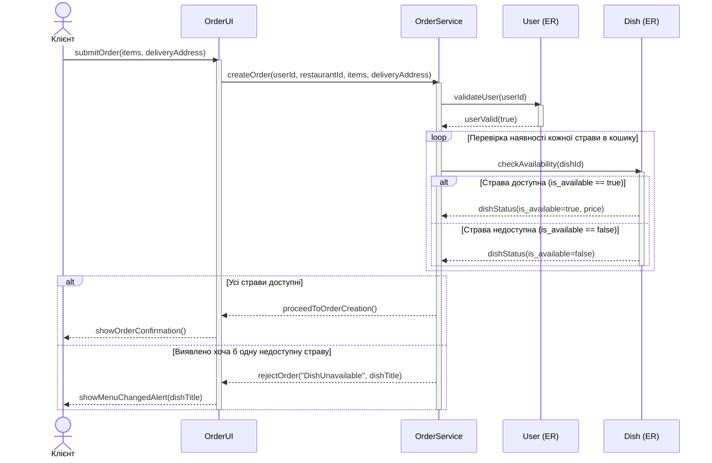
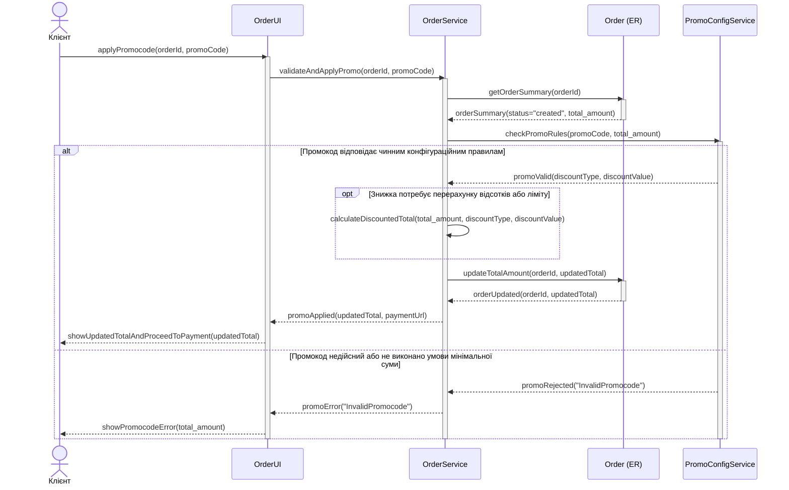
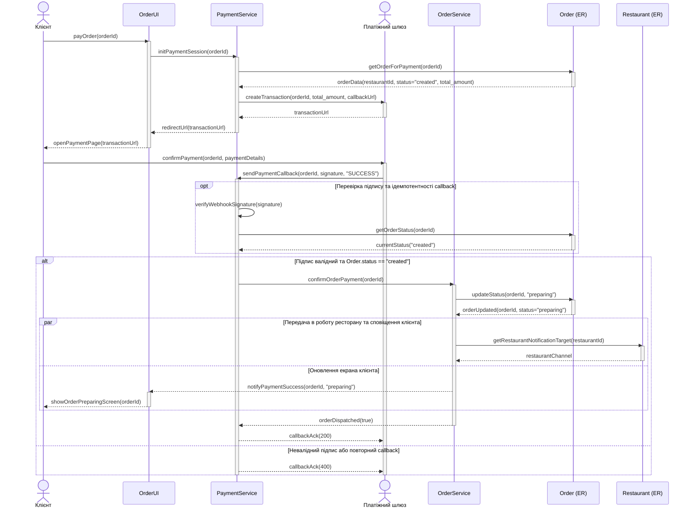
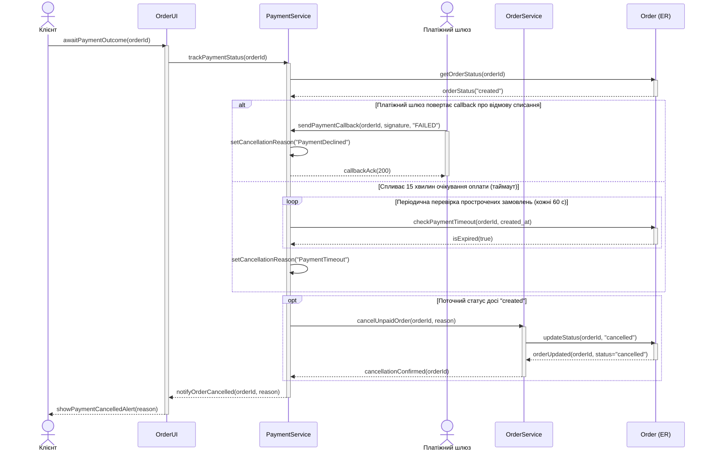

# Sequence-діаграми для прецеденту UC-2 «Оформити замовлення»

Нижче наведено деталізацію внутрішньої взаємодії компонентів системи та сутностей ER-моделі для кожного сценарію Gherkin із Завдання 2.

---

## Scenario 1: Успішне створення замовлення з перевіркою наявності страв (Крок S1)

---

## Scenario 2: Відхилення замовлення через недоступність страви

---

## Scenario 3: Успішне застосування промокоду під час оформлення (UC-6)

---

## Scenario 4: Підтвердження оплати від платіжного шлюзу (UC-5)

---

## Scenario 5: Скасування замовлення при відмові оплати або таймауті (UC-5)

